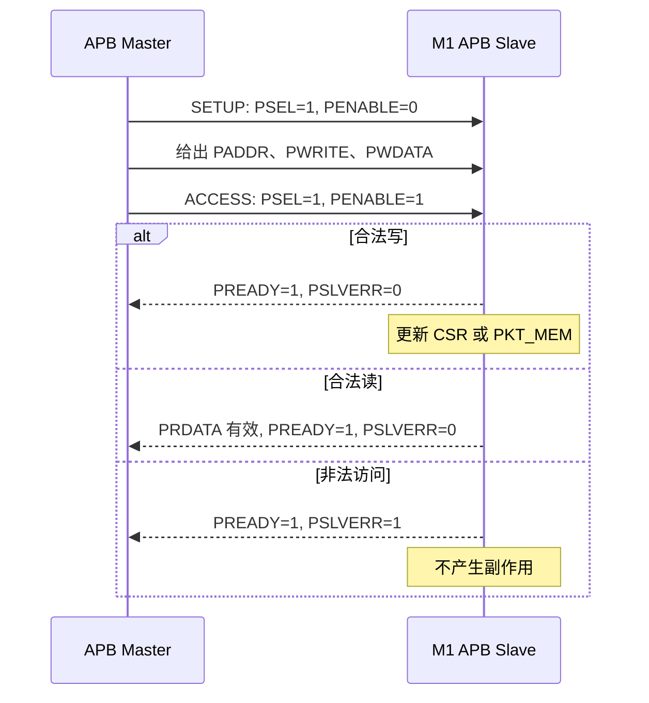

# APB Access Timing

## 周期表

| 周期 | 阶段 | PSEL | PENABLE | PWRITE | 说明 |
|---|---|---:|---:|---:|---|
| C0 | IDLE | 0 | 0 | 0 | 无传输 |
| C1 | SETUP | 1 | 0 | 1/0 | 地址、方向和写数据有效 |
| C2 | ACCESS | 1 | 1 | 1/0 | 传输完成，读数据或错误响应有效 |
| C3 | IDLE | 0 | 0 | 0 | 传输结束 |

## 一次 APB 写传输

```text
周期        C0          C1          C2          C3
阶段        IDLE        SETUP       ACCESS       IDLE
PSEL        0           1           1           0
PENABLE     0           0           1           0
PWRITE      0           1           1           0
PADDR       无效        0x040       0x040       无效
PWDATA      无效        DATA        DATA        无效
PREADY      -           -           1           -
PSLVERR     -           -           0/1         -
```

## 规则

- 合法写：ACCESS 阶段 `PREADY=1, PSLVERR=0`，在有效时钟边沿更新 CSR 或 SRAM。
- 合法读：ACCESS 阶段返回 `PRDATA`，并且 `PSLVERR=0`。
- 非法访问：可以 `PREADY=1`，但 `PSLVERR=1`，且不能修改内部状态。

## Mermaid 时序


