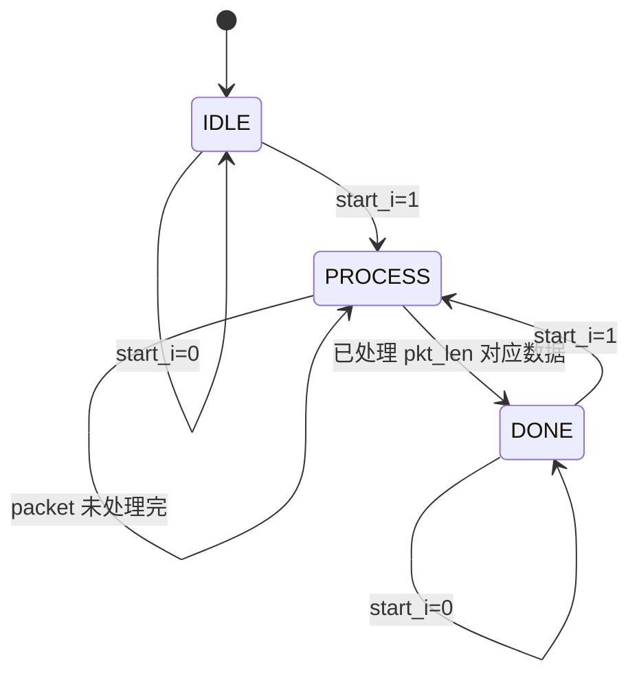

# M3 FSM

## 状态转移

## 状态输出

| 状态 | `busy_o` | `done_o` | `mem_rd_en_o` |
|---|---:|---:|---:|
| IDLE | 0 | 0 | 0 |
| PROCESS | 1 | 0 | 1 |
| DONE | 0 | 1 | 0 |

## 处理流程

1. IDLE 接收到 `start_i`。
2. 进入 PROCESS，初始化计数器并读取 Word0。
3. 提取 `pkt_len`、`pkt_type`、`flags` 和 `hdr_chk`。
4. 检查长度、类型和头校验。
5. 读取 payload，计算 sum 和 XOR。
6. 保存结果和错误标志。
7. 进入 DONE，保持结果有效。
8. 收到下一次合法 `start_i` 后清除上一帧状态并重新进入 PROCESS。
