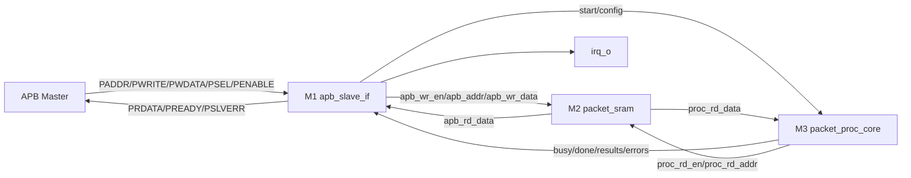

# PPA-Lite Top Connection

## 模块连接图

## 主要信号

### M1 到 M2

- `pkt_mem_we_o`
- `pkt_mem_addr_o`
- `pkt_mem_wdata_o`
- `pkt_mem_re_o`

### M1 到 M3

- `start_o`
- `enable_o`
- `algo_mode_o`
- `type_mask_o`
- `exp_pkt_len_o`

### M3 到 M1

- `busy_o`
- `done_o`
- `format_ok_o`
- `length_error_o`
- `type_error_o`
- `chk_error_o`
- `res_pkt_len_o`
- `res_pkt_type_o`
- `res_payload_sum_o`
- `res_payload_xor_o`

M1 是软件接口，M2 是存储器，M3 是处理核心，`ppa_top` 主要负责连线、时钟和复位分发。
